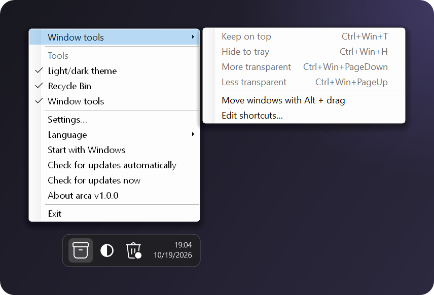
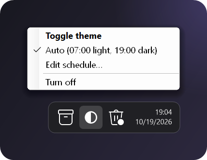
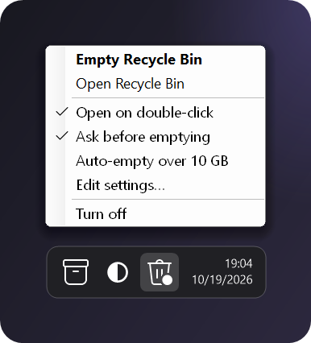

<p align="center">
  
</p>

<p align="center">
  <a href="https://github.com/ellarupion/arca/releases/latest"></a>
  <a href="https://github.com/ellarupion/arca/releases"></a>
  
  <a href="LICENSE"></a>
</p>

<p align="center">
  <b>English</b> · <a href="README.ru.md">Русский</a>
</p>

---

*arca* is Latin for "chest". It's one small exe that keeps a few handy Windows tools in the tray:
a light/dark theme switch, the Recycle Bin, and shortcuts for working with windows.
Turn on the ones you need, ignore the rest.

- **Tiny.** One ~55 KB exe, nothing to install, nothing running in the background except the tray icons.
- **Native look.** Icons use the same system font as the rest of the tray and follow your taskbar's light or dark mode.
- **Updates itself** from GitHub Releases.
- **English and Russian**, following your Windows language.

## Download

**[⬇ arca.exe](https://github.com/ellarupion/arca/releases/latest/download/arca.exe)** — put it anywhere and run it.
Needs .NET Framework 4, which is already part of Windows 10 and 11.

> Windows may show *"Windows protected your PC"* the first time, because the exe isn't code-signed.
> Click **More info → Run anyway**.

## What's inside

### The main menu

Click the box icon next to the clock. From here you switch tools on and off, change the language,
turn on autostart and check for updates.

<p align="center"></p>

### Window tools

Shortcuts that work on whatever window is active:

<p align="center"></p>

- **Keep on top** pins a window above all others. Press again to release it.
- **Hide to tray** takes the window off the taskbar and gives it its own tray icon. Click the icon to bring it back.
- **Transparency** goes down to 20% in 10% steps.
- **Alt + drag** moves a window by grabbing it anywhere, not just the title bar. It's off by default, because some apps use Alt + click themselves.

When arca exits, every window goes back to normal. If arca gets killed, hidden windows reappear the next time it starts.

<table>
  <tr>
    <td width="50%" valign="top">
      <h3>Light/dark theme</h3>
      <p><b>Click</b> the ◐ icon to switch the Windows theme.<br>
      <b>Right click</b> to switch on a schedule, 07:00 light and 19:00 dark by default.</p>
      <p>A manual switch stays until the next scheduled one.</p>
      
    </td>
    <td width="50%" valign="top">
      <h3>Recycle Bin</h3>
      <p><b>Double click</b> to open the bin. <b>Right click</b>: <i>Empty Recycle Bin</i> comes first.</p>
      <p>Can empty itself once it grows past a size limit. The icon gets a dot when there's something inside.</p>
      
    </td>
  </tr>
</table>

## Settings

Everything is in `arca.ini` next to the exe (**Settings…** in the menu opens it). Changes apply as soon as you save.

```ini
[arca]
language=auto        ; auto, en or ru
updates=1
theme=1              ; which tools are on
bin=1
windows=1

[theme]
light=07:00
dark=19:00
auto=1

[bin]
doubleclick=1
confirm=1
auto=0               ; empty automatically...
limit_gb=10          ; ...once the bin is bigger than this

[windows]
on_top=Ctrl+Win+T
hide=Ctrl+Win+H
fade=Ctrl+Win+PageDown
unfade=Ctrl+Win+PageUp
alt_drag=0
```

Shortcuts take `Ctrl`, `Alt`, `Shift`, `Win` and any key name (`T`, `F9`, `PageUp`, `Space`…).
Leave one empty to turn it off. If another app already uses a shortcut, arca tells you.

## Good to know

- Windows of apps running **as administrator** can only be changed when arca runs as administrator too.
- arca checks `api.github.com/repos/ellarupion/arca/releases/latest` at startup and every 12 hours.
  That's the only network request it makes, and you can turn it off.
- An update downloads the new `arca.exe`, swaps it in place and restarts.

## Build from source

The C# compiler ships with Windows, so there's nothing to install:

```
build.cmd
```

The README images are drawn from the real menus by [`docs/render.cs`](docs/render.cs).

## License

[MIT](LICENSE)
