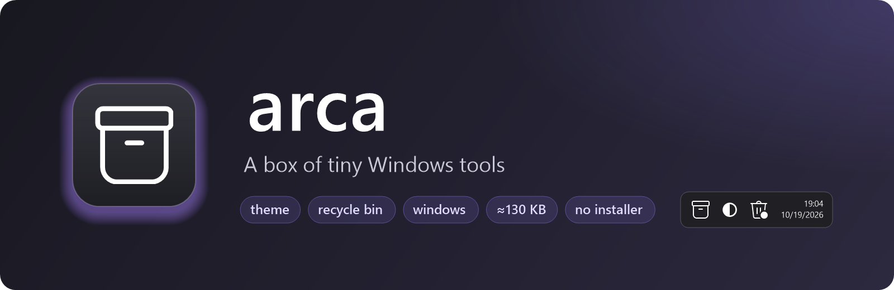
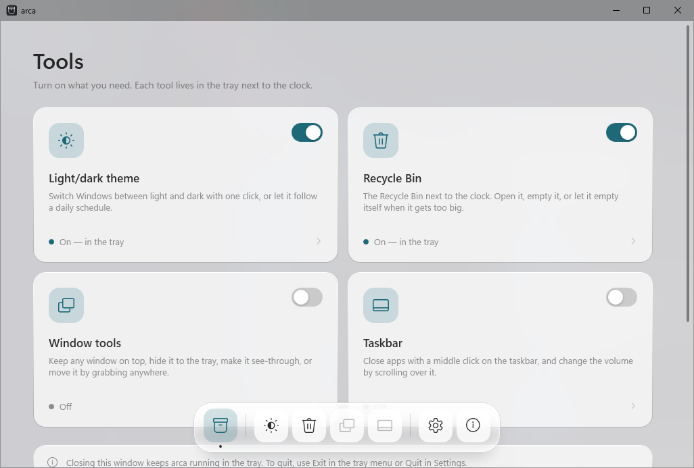
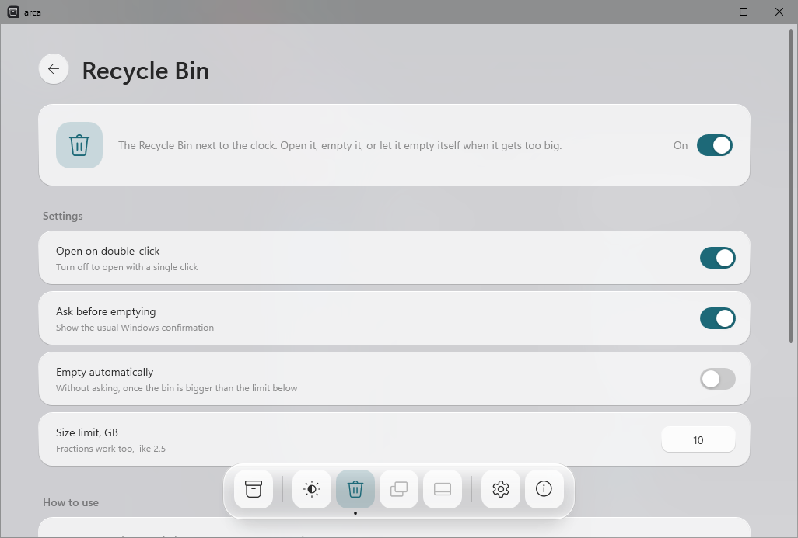
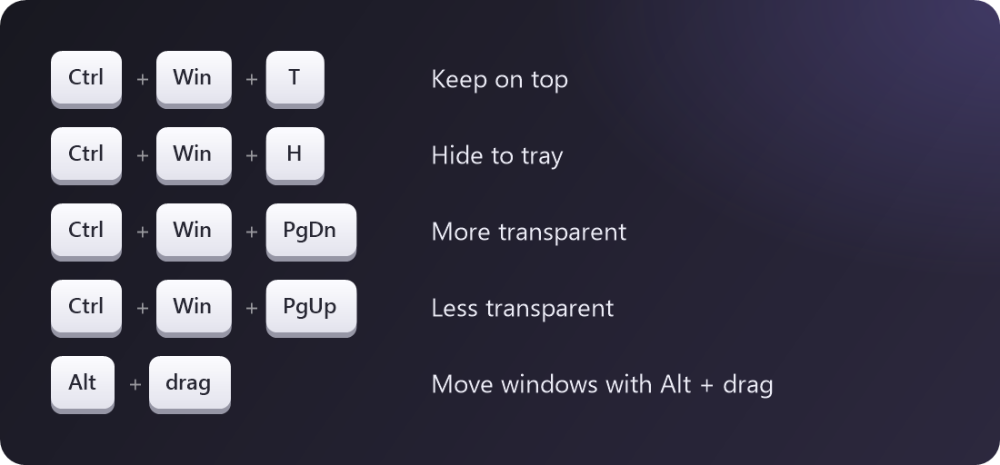
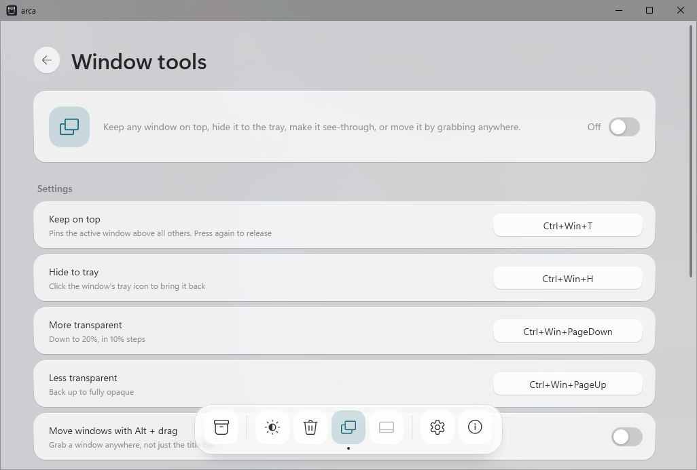
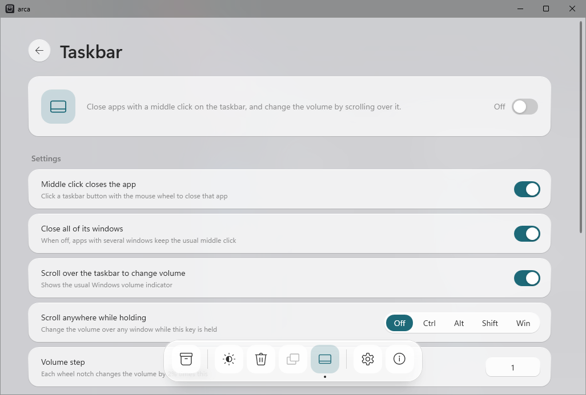

<p align="center">
  
</p>

<p align="center">
  <a href="https://github.com/ellarupion/arca/releases/latest"></a>
  <a href="https://github.com/ellarupion/arca/releases"></a>
  
  <a href="LICENSE"></a>
</p>

<p align="center">
  <b>English</b> · <a href="README.ru.md">Русский</a>
</p>

---

*arca* is Latin for "chest". It's a small Windows app that collects a few handy tools in one place:
a light/dark theme switch, the Recycle Bin next to the clock, shortcuts for working with windows, and taskbar tweaks.
Open arca, turn on what you need, set it up, and close it. The tools keep running in the tray.

<p align="center">
  <picture>
    <source media="(prefers-color-scheme: dark)" srcset="docs/window-tools-en-dark.png">
    
  </picture>
</p>

- **One place for everything.** A glass dock at the bottom switches between tools; every tool has its own page with a description, an on/off switch and its settings.
- **Glass look.** A see-through window, a floating frosted dock that magnifies icons under the mouse, your accent colour, light and dark theme.
- **Tiny.** One ~130 KB exe, nothing to install, no background services.
- **Updates itself** from GitHub Releases.
- **English and Russian**, following your Windows language.

## Download

**[⬇ arca.exe](https://github.com/ellarupion/arca/releases/latest/download/arca.exe)** — put it anywhere and run it.
Needs .NET Framework 4.6.2 or newer, which is already part of Windows 10 and 11.

> Windows may show *"Windows protected your PC"* the first time, because the exe isn't code-signed.
> Click **More info → Run anyway**.

## Tools

### Recycle Bin

The Recycle Bin next to the clock. **Double click** opens it, **right click** has *Empty Recycle Bin* as the first item.
It can empty itself once it grows past a size limit, and the icon gets a dot when there's something inside.

<p align="center">
  <picture>
    <source media="(prefers-color-scheme: dark)" srcset="docs/window-bin-en-dark.png">
    
  </picture>
</p>

### Window tools

Shortcuts that work on whatever window is active:

<p align="center"></p>

- **Keep on top** pins a window above all others. Press again to release it.
- **Hide to tray** takes the window off the taskbar and gives it its own tray icon. Click the icon to bring it back.
- **Transparency** goes down to 20% in 10% steps.
- **Alt + drag** moves a window by grabbing it anywhere. It's off by default, because some apps use Alt + click themselves.

To change a shortcut, click it in arca and press the new one. Backspace turns it off.
When arca exits, every window goes back to normal.

<p align="center">
  <picture>
    <source media="(prefers-color-scheme: dark)" srcset="docs/window-windows-en-dark.png">
    
  </picture>
</p>

### Taskbar

- **Middle click closes the app.** Click a taskbar button with the mouse wheel and that app closes, the same as clicking its ×.
- **Scroll over the taskbar to change volume**, with the usual Windows volume indicator. Optionally anywhere, while holding Ctrl, Alt, Shift or Win.

This one is off until you turn it on, because it changes how the taskbar reacts. If you use Windhawk mods that do the same,
turn them off. Windows 11 only.

<p align="center">
  <picture>
    <source media="(prefers-color-scheme: dark)" srcset="docs/window-taskbar-en-dark.png">
    
  </picture>
</p>

### Light/dark theme

Click the ◐ icon next to the clock to switch the Windows theme, or let arca switch it on a schedule
(07:00 light and 19:00 dark by default). A manual switch stays until the next scheduled one.

## How it runs

- Opening `arca.exe` shows the window. Closing the window keeps arca in the tray, and the box icon next to the clock brings it back.
- With **Start with Windows** on, arca starts quietly in the tray.
- To quit completely, use **Exit** in the tray menu or **Quit** in Settings. Every window goes back to normal.

## Settings file

Everything you set in the window is saved to `arca.ini` next to the exe, so arca is portable.
You can also edit the file by hand; changes apply as soon as you save.

```ini
[arca]
language=auto        ; auto, en or ru
updates=1
theme=1              ; which tools are on
bin=1
windows=1
taskbar=0

[theme]
light=07:00
dark=19:00
auto=1

[bin]
doubleclick=1
confirm=1
auto=0               ; empty automatically...
limit_gb=10          ; ...once the bin is bigger than this

[windows]
on_top=Ctrl+Win+T
hide=Ctrl+Win+H
fade=Ctrl+Win+PageDown
unfade=Ctrl+Win+PageUp
alt_drag=0

[taskbar]
middle_close=1
close_all=1
volume=1
volume_anywhere=off  ; off, ctrl, alt, shift or win
volume_step=1        ; each wheel notch = 2% x this
```

## Good to know

- Windows of apps running **as administrator** can only be changed when arca runs as administrator too.
- arca checks `api.github.com/repos/ellarupion/arca/releases/latest` at startup and every 12 hours.
  That's the only network request it makes, and you can turn it off.
- An update downloads the new `arca.exe`, swaps it in place and restarts.

## Build from source

The C# compiler and WPF ship with Windows, so there's nothing to install:

```
build.cmd
```

The banner and shortcut images are drawn by [`docs/render.cs`](docs/render.cs).

## License

[MIT](LICENSE)
