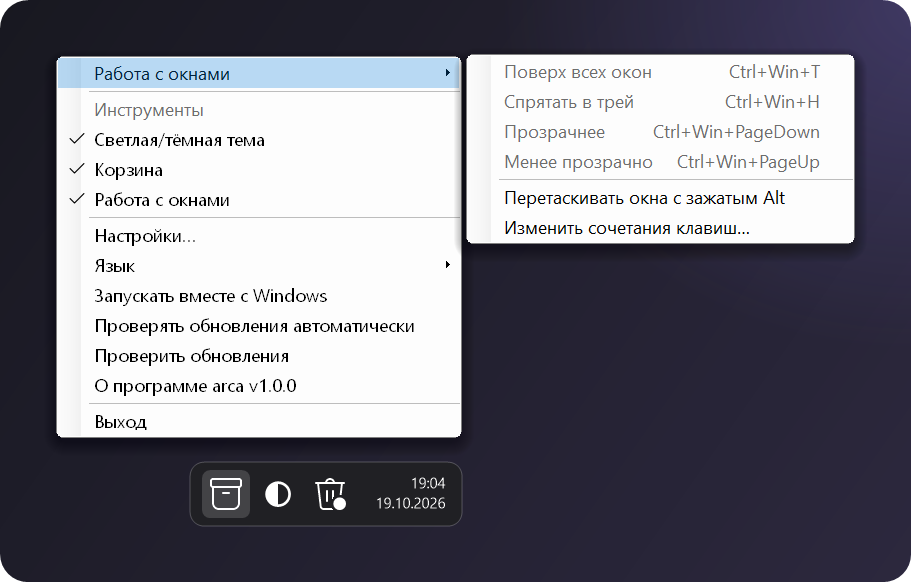
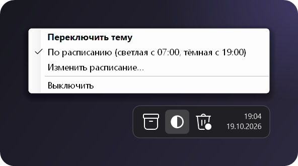
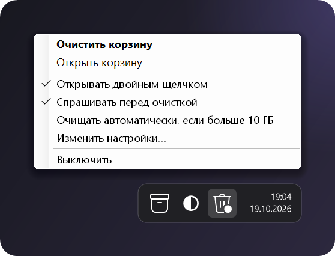

<p align="center">
  
</p>

<p align="center">
  <a href="https://github.com/ellarupion/arca/releases/latest"></a>
  <a href="https://github.com/ellarupion/arca/releases"></a>
  
  <a href="LICENSE"></a>
</p>

<p align="center">
  <a href="README.md">English</a> · <b>Русский</b>
</p>

---

*arca* по-латински «ларец». Это один маленький exe, который держит в трее несколько полезных утилит:
переключатель светлой и тёмной темы, корзину и горячие клавиши для работы с окнами.
Включите те, что нужны, остальные можно не трогать.

- **Маленькая.** Один exe около 55 КБ, ничего не надо устанавливать, в фоне только значки в трее.
- **Выглядит как родная.** Значки нарисованы тем же системным шрифтом, что и остальные значки в трее, и подстраиваются под светлую или тёмную панель задач.
- **Обновляется сама** из GitHub Releases.
- **Русский и английский** интерфейс, по умолчанию как в Windows.

## Скачать

**[⬇ arca.exe](https://github.com/ellarupion/arca/releases/latest/download/arca.exe)** — положите куда угодно и запустите.
Нужен .NET Framework 4, он уже есть в Windows 10 и 11.

> При первом запуске Windows может показать *«Система Windows защитила ваш компьютер»*: у exe нет цифровой подписи.
> Нажмите **Подробнее → Выполнить в любом случае**.

## Что внутри

### Главное меню

Клик по значку ящика у часов. Здесь включаются и выключаются утилиты, меняется язык,
включается автозапуск и проверяются обновления.

<p align="center"></p>

### Работа с окнами

Горячие клавиши действуют на активное окно:

<p align="center"></p>

- **Поверх всех окон** закрепляет окно над остальными. Повторное нажатие отпускает его.
- **Спрятать в трей** убирает окно с панели задач, и у него появляется свой значок в трее. Клик по значку возвращает окно.
- **Прозрачность** меняется шагами по 10%, до 20%.
- **Alt + перетаскивание** двигает окно, если взяться за любое место, а не только за заголовок. По умолчанию выключено: некоторые программы сами используют Alt + клик.

При выходе из arca все окна возвращаются как было. Если arca закрыли принудительно, скрытые окна появятся при следующем запуске.

<table>
  <tr>
    <td width="50%" valign="top">
      <h3>Светлая/тёмная тема</h3>
      <p><b>Клик</b> по значку ◐ переключает тему Windows.<br>
      <b>Правый клик</b> включает расписание: по умолчанию светлая с 07:00, тёмная с 19:00.</p>
      <p>Ручное переключение действует до следующего переключения по расписанию.</p>
      
    </td>
    <td width="50%" valign="top">
      <h3>Корзина</h3>
      <p><b>Двойной клик</b> открывает корзину. <b>Правый клик</b>: первым пунктом <i>Очистить корзину</i>.</p>
      <p>Может очищаться автоматически, когда становится больше заданного размера. Когда в корзине что-то есть, на значке появляется точка.</p>
      
    </td>
  </tr>
</table>

## Настройки

Все настройки лежат в `arca.ini` рядом с exe (пункт **Настройки…** в меню открывает его). Изменения применяются сразу после сохранения.

```ini
[arca]
language=auto        ; auto, en или ru
updates=1
theme=1              ; какие утилиты включены
bin=1
windows=1

[theme]
light=07:00
dark=19:00
auto=1

[bin]
doubleclick=1
confirm=1
auto=0               ; очищать автоматически,
limit_gb=10          ; если корзина больше стольких ГБ

[windows]
on_top=Ctrl+Win+T
hide=Ctrl+Win+H
fade=Ctrl+Win+PageDown
unfade=Ctrl+Win+PageUp
alt_drag=0
```

В сочетаниях можно использовать `Ctrl`, `Alt`, `Shift`, `Win` и любую клавишу (`T`, `F9`, `PageUp`, `Space`…).
Пустое значение выключает сочетание. Если сочетание уже занято другой программой, arca об этом скажет.

## Полезно знать

- Окна программ, запущенных **от администратора**, можно менять, только если arca тоже запущена от администратора.
- arca проверяет `api.github.com/repos/ellarupion/arca/releases/latest` при запуске и раз в 12 часов.
  Других сетевых запросов она не делает, а проверку можно выключить.
- Обновление скачивает новый `arca.exe`, подменяет старый и перезапускает arca.

## Сборка из исходников

Компилятор C# уже есть в Windows, ставить ничего не нужно:

```
build.cmd
```

Картинки для README рисуются из настоящих меню скриптом [`docs/render.cs`](docs/render.cs).

## Лицензия

[MIT](LICENSE)
