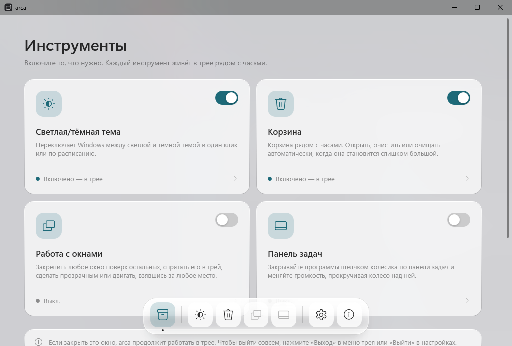
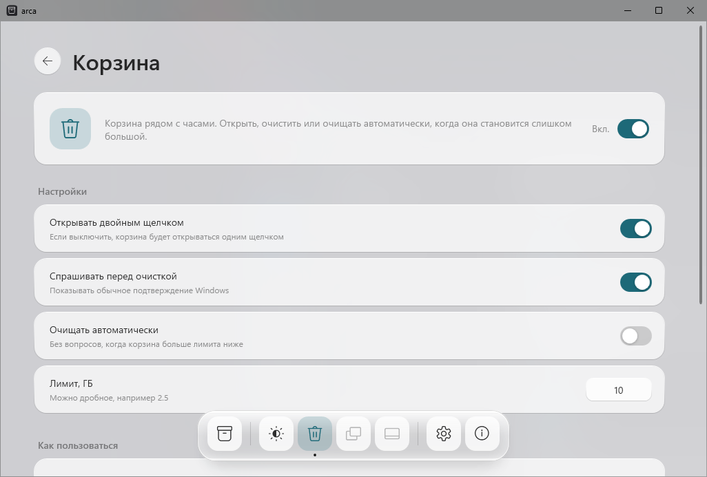
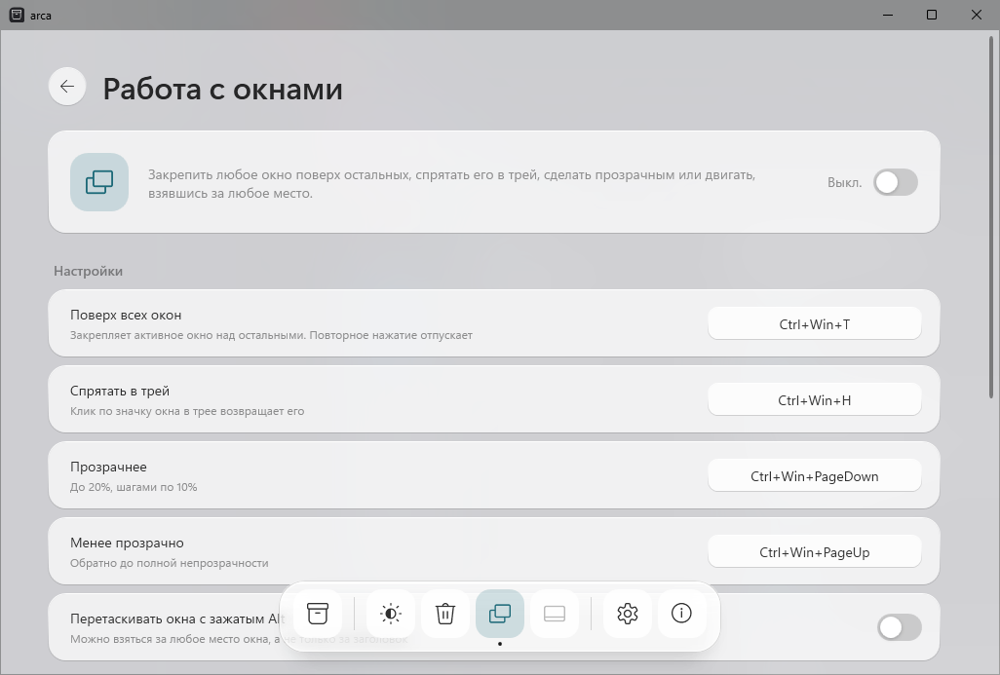
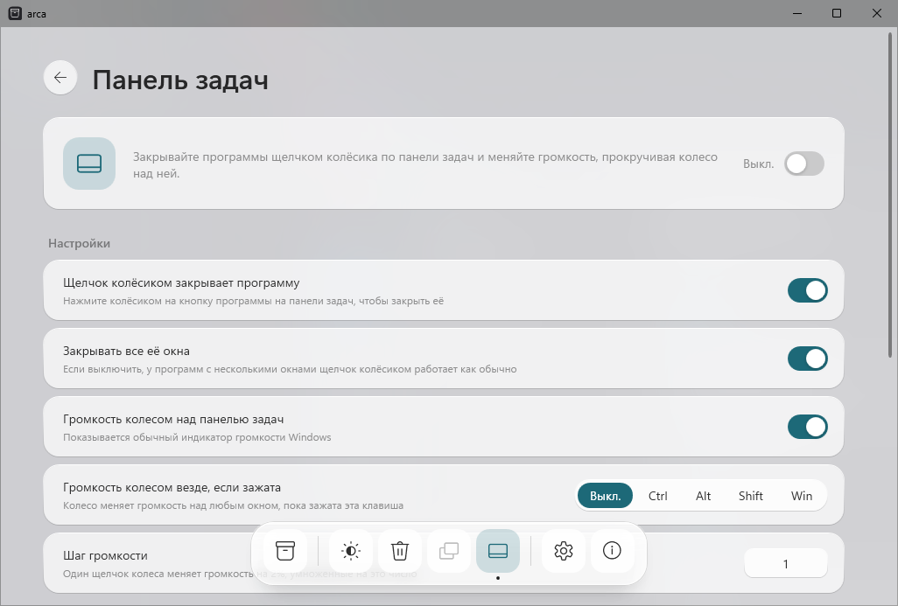

<p align="center">
  
</p>

<p align="center">
  <a href="https://github.com/ellarupion/arca/releases/latest"></a>
  <a href="https://github.com/ellarupion/arca/releases"></a>
  
  <a href="LICENSE"></a>
</p>

<p align="center">
  <a href="README.md">English</a> · <b>Русский</b>
</p>

---

*arca* по-латински «ларец». Это небольшое приложение для Windows, которое собирает несколько полезных инструментов в одном месте:
переключатель светлой и тёмной темы, корзину у часов, горячие клавиши для работы с окнами и улучшения панели задач.
Откройте arca, включите нужное, настройте и закройте окно. Инструменты продолжат работать в трее.

<p align="center">
  <picture>
    <source media="(prefers-color-scheme: dark)" srcset="docs/window-tools-ru-dark.png">
    
  </picture>
</p>

- **Всё в одном месте.** Стеклянный док внизу переключает инструменты, у каждого своя страница: описание, переключатель и настройки.
- **Стекло.** Полупрозрачное окно, плавающий матовый док, иконки в котором увеличиваются под мышью, ваш цвет акцента, светлая и тёмная тема.
- **Маленькая.** Один exe около 130 КБ, ничего не надо устанавливать, никаких фоновых служб.
- **Обновляется сама** из GitHub Releases.
- **Русский и английский** интерфейс, по умолчанию как в Windows.

## Скачать

**[⬇ arca.exe](https://github.com/ellarupion/arca/releases/latest/download/arca.exe)** — положите куда угодно и запустите.
Нужен .NET Framework 4.6.2 или новее, он уже есть в Windows 10 и 11.

> При первом запуске Windows может показать *«Система Windows защитила ваш компьютер»*: у exe нет цифровой подписи.
> Нажмите **Подробнее → Выполнить в любом случае**.

## Инструменты

### Корзина

Корзина рядом с часами. **Двойной клик** открывает её, в меню по **правому клику** первым пунктом идёт *Очистить корзину*.
Может очищаться автоматически, когда становится больше заданного размера. Когда в корзине что-то есть, на значке появляется точка.

<p align="center">
  <picture>
    <source media="(prefers-color-scheme: dark)" srcset="docs/window-bin-ru-dark.png">
    
  </picture>
</p>

### Работа с окнами

Горячие клавиши действуют на активное окно:

<p align="center"></p>

- **Поверх всех окон** закрепляет окно над остальными. Повторное нажатие отпускает его.
- **Спрятать в трей** убирает окно с панели задач, и у него появляется свой значок в трее. Клик по значку возвращает окно.
- **Прозрачность** меняется шагами по 10%, до 20%.
- **Alt + перетаскивание** двигает окно, если взяться за любое место. По умолчанию выключено: некоторые программы сами используют Alt + клик.

Чтобы поменять сочетание, нажмите на него в arca и нажмите новое. Backspace выключает сочетание.
При выходе из arca все окна возвращаются как было.

<p align="center">
  <picture>
    <source media="(prefers-color-scheme: dark)" srcset="docs/window-windows-ru-dark.png">
    
  </picture>
</p>

### Панель задач

- **Щелчок колёсиком закрывает программу.** Нажмите колёсиком на кнопку программы на панели задач, и она закроется, как по кнопке ×.
- **Громкость колесом над панелью задач**, с обычным индикатором громкости Windows. Можно и над любым окном, пока зажата Ctrl, Alt, Shift или Win.

Этот инструмент выключен, пока вы его не включите: он меняет поведение панели задач. Если у вас стоят моды Windhawk
с тем же действием, выключите их. Только Windows 11.

<p align="center">
  <picture>
    <source media="(prefers-color-scheme: dark)" srcset="docs/window-taskbar-ru-dark.png">
    
  </picture>
</p>

### Светлая/тёмная тема

Клик по значку ◐ у часов переключает тему Windows. Можно включить расписание
(по умолчанию светлая с 07:00, тёмная с 19:00). Ручное переключение действует до следующего переключения по расписанию.

## Как arca работает

- Запуск `arca.exe` открывает окно. Если закрыть окно, arca останется в трее, а значок ящика у часов откроет его снова.
- Если включено **Запускать вместе с Windows**, arca стартует тихо, сразу в трей.
- Чтобы выйти совсем, нажмите **Выход** в меню трея или **Выйти** в настройках. Все окна вернутся как было.

## Файл настроек

Всё, что вы настраиваете в окне, сохраняется в `arca.ini` рядом с exe, так что arca можно носить на флешке.
Файл можно править и руками: изменения применяются сразу после сохранения.

```ini
[arca]
language=auto        ; auto, en или ru
updates=1
theme=1              ; какие инструменты включены
bin=1
windows=1
taskbar=0

[theme]
light=07:00
dark=19:00
auto=1

[bin]
doubleclick=1
confirm=1
auto=0               ; очищать автоматически,
limit_gb=10          ; если корзина больше стольких ГБ

[windows]
on_top=Ctrl+Win+T
hide=Ctrl+Win+H
fade=Ctrl+Win+PageDown
unfade=Ctrl+Win+PageUp
alt_drag=0

[taskbar]
middle_close=1
close_all=1
volume=1
volume_anywhere=off  ; off, ctrl, alt, shift или win
volume_step=1        ; один щелчок колеса = 2% x это число
```

## Полезно знать

- Окна программ, запущенных **от администратора**, можно менять, только если arca тоже запущена от администратора.
- arca проверяет `api.github.com/repos/ellarupion/arca/releases/latest` при запуске и раз в 12 часов.
  Других сетевых запросов она не делает, а проверку можно выключить.
- Обновление скачивает новый `arca.exe`, подменяет старый и перезапускает arca.

## Сборка из исходников

Компилятор C# и WPF уже есть в Windows, ставить ничего не нужно:

```
build.cmd
```

Баннер и картинку с горячими клавишами рисует [`docs/render.cs`](docs/render.cs).

## Лицензия

[MIT](LICENSE)
